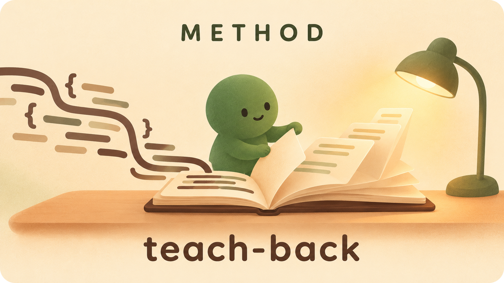

<!--
GitHub metadata, applied by hand in repo Settings (not rendered):
About: Turn a codebase you built into a 4-level course with cited fact ledgers and story-shaped HTML pages, so you can defend it without AI — a Claude Code method with verifier agents and Python checkers.
Topics (ranked): claude-code, codebase-understanding, learning, active-recall, interview-prep, ai-assisted-development, fact-checking, spaced-repetition, prompt-engineering, ai-agents, education, html, python, markdown, anthropic
Social preview: docs/media/hero-glass.jpg (1280x640, git-ignored) made from docs/media/hero.png with --glass.
-->

# teach-back — Learn the Code You Built With AI

**Explain your own project with no AI beside you.**  
*A method for Claude Code that turns a codebase into four cited, verified levels (pitch, whiteboard, "why not X?", interview) and builds each level as a story-shaped HTML page you answer as you read.*

[](LICENSE)
[](prompts/00-kickoff.md)
[](scripts/check_cites.py)



| I want to… | Where | What it is |
|---|---|---|
| **Run the whole method** | [`prompts/00-kickoff.md`](prompts/00-kickoff.md) | One brief for the manager: folders, frozen snapshot, tiers, gates, logs |
| **See what a page looks like** | [`kit/template.html`](kit/template.html) | A demo page with every component once: cards, diagram, chips, rail |
| **Check that citations are real** | [`scripts/check_cites.py`](scripts/check_cites.py) | Every `path:line` must exist and be in range |
| **Catch a page that drifted from its ledger** | [`scripts/check_drift.py`](scripts/check_drift.py) | Numbers and "you did X" sentences the ledger does not back |
| **Prove every reveal card opens** | [`scripts/reveal_test.sh`](scripts/reveal_test.sh) | Headless Chrome clicks every card and counts what stays hidden |
| **Write the rules for a page** | [`STYLE-GUIDE.md`](STYLE-GUIDE.md) | Ten rules and a pass/fail checklist, tied to published research |
| **Build several courses unattended** | [`prompts/workflow-course.js`](prompts/workflow-course.js) | A Claude Code Workflow script that chains every brief, with no gates |
| **Upgrade older pages to the current layout** | [`scripts/patch_layout.py`](scripts/patch_layout.py) | Index on the left edge, reading column centred, fixed 17px text |

## Quick start

```bash
git clone https://github.com/AdinathChaudhari/teach-back && cd teach-back
open prompts/00-kickoff.md        # fill the {{PLACEHOLDERS}}, then paste it into Claude Code
python3 scripts/check_cites.py kit/template.html --ledger kit/demo/ledger.md --root kit/demo
bash scripts/reveal_test.sh kit/template.html
```

1. **Open the kickoff brief** and fill in your product name, repo paths and a folder for the output.
2. **Paste it into Claude Code** from the folder where the course should live. The manager agent takes it from there.
3. **Answer at each gate.** The run stops after the plan, after the first level, and after the pages are built.
4. **Open the pages** in a browser. They are single files and work from disk.

That's it. Everything below is detail.

---

## Demo

The kit ships with a tiny fictional product, a URL shortener called snip. Its demo page cites a small demo source file, so the checkers have something real to check. These are the real outputs, run from the repo root:

```text
$ python3 scripts/check_cites.py kit/template.html --ledger kit/demo/ledger.md --root kit/demo
10 citations, 0 bad

$ python3 scripts/check_drift.py kit/template.html kit/demo/ledger.md
NUMBERS not in ledger: none
USER-ACTION sentences: 1
  - You built snip, a tiny URL shortener. This page is a demo of the teach-back page kit: every component appears once, with fictional content. Answer each bet before you open it.

$ bash scripts/reveal_test.sh kit/template.html
answers=4 stillHidden=0
```

The checker also fails loudly. A citation to a line that does not exist:

```text
$ printf 'save() re-rolls a taken code (src/snip/store.py:44) and logs it (src/snip/store.py:99).\n' | python3 scripts/check_cites.py /dev/stdin --root kit/demo
OUT-OF-RANGE src/snip/store.py:99-99 (file has 48)
2 citations, 1 bad
```

`check_drift.py` is a report, not a gate. It lists sentences that say what "you" did so a verifier can confirm the ledger backs each one.

---

## How it works

**Four levels, one test each.** Every product gets all four.

| Level | What it gives you | Test of success |
|---|---|---|
| 1 Basics | The problem, who it is for, a 2-minute pitch, the vocabulary | You can pitch it to a non-engineer |
| 2 Deeper | The flow of one run, the main parts, the key design choices | You can draw it on a whiteboard |
| 3 Deep dive | Real code, each decision with its reason, rejected options, failures, numbers | You can answer "why not X?" |
| 4 Interview | Likely questions, model answers to say aloud, follow-ups, traps | You can answer out loud, no notes |

Each level ends with five self-check questions. A separate `GAPS.md` lists what the code does not prove.

**Ledger first, then page.** A worker writes each level as a markdown fact ledger. Every claim cites `path:line` in a frozen snapshot of the code (`git archive` of one commit, so line numbers never drift). A separate verifier agent opens each cited line and fixes the claim, the line or the era tag. Only then does a builder turn the ledger into an HTML page, and a second verifier checks that the page says what the ledger says.

**The page.** Each section opens on a small puzzle with a bet-first card: you type or pick an answer before the reveal button unlocks. Sections end on an open question the next section answers. Processes are step-through diagrams that also read as a plain list. Terms are tap-to-define. The page has a left rail, a progress line, an A−/A/A+ text-size control and light and dark themes, and it works with JavaScript off. The rules and the checklist are in [`STYLE-GUIDE.md`](STYLE-GUIDE.md).

**Gates and agent tiers.** The human approves at three points: the plan, the first finished level, and the finished pages. One planning pass runs on a strong model. Workers and verifiers run on a mid model. A manager launches them and audits the files on disk instead of trusting reports, because a report can look right and be narrow or wrong.

**Private and public.** Material that must never be said aloud is tagged `[PRIVATE-ONLY]` and shown in a visible box, and Level 4 pairs every private answer with a public-safe one.

**Design choices and the evidence.** Commit-first reveal, spaced re-checks, open loops, a few pre-taught words and diagram steps come from learning research: Dunlosky et al. (2013), Roediger and Karpicke (2006), Mayer's multimedia principles and others, listed in [`STYLE-GUIDE.md`](STYLE-GUIDE.md). Treat the evidence as provisional. The research notes in [`research/`](research/) mostly read abstracts and summaries, so every effect is direction, not a promise, and story, open loops and layout choices for attention are bets.

The first course made with this method was built on the author's own code-review tool, and the prompts here are the generalized form of that run.

## Requirements

- Claude Code, to run the prompts and agents.
- Python 3 for `check_cites.py` and `check_drift.py` (standard library only).
- Google Chrome or Chromium for `reveal_test.sh`. Set `CHROME` to its binary; the default is the macOS app path.
- Git, for the frozen snapshot.

## License

MIT. See [`LICENSE`](LICENSE).

## Acknowledgements

- [antivibe](https://github.com/mohi-devhub/antivibe) by M Mohith (MIT) inspired the verifier pass and the concept map. Ideas only; see [`NOTICE.md`](NOTICE.md).
- Learning science: Dunlosky et al. (2013); Roediger and Karpicke (2006); Karpicke and Blunt (2011); Cepeda et al. (2006); Bjork and Bjork (2011); Slamecka and Graf (1978); Paivio's dual coding; Mayer's multimedia learning. Full references in [`STYLE-GUIDE.md`](STYLE-GUIDE.md).
